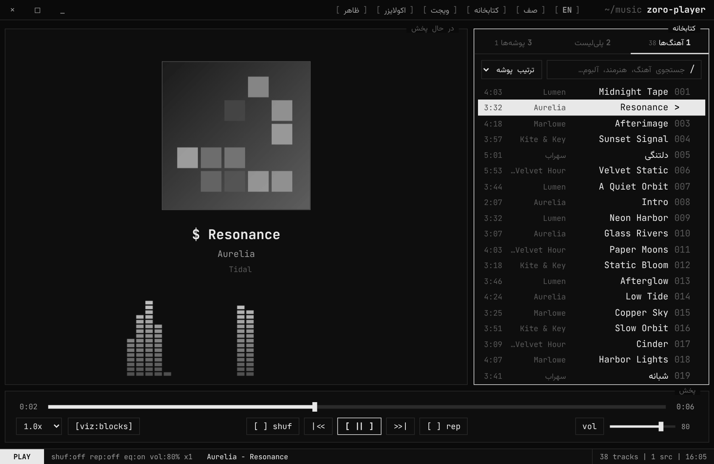
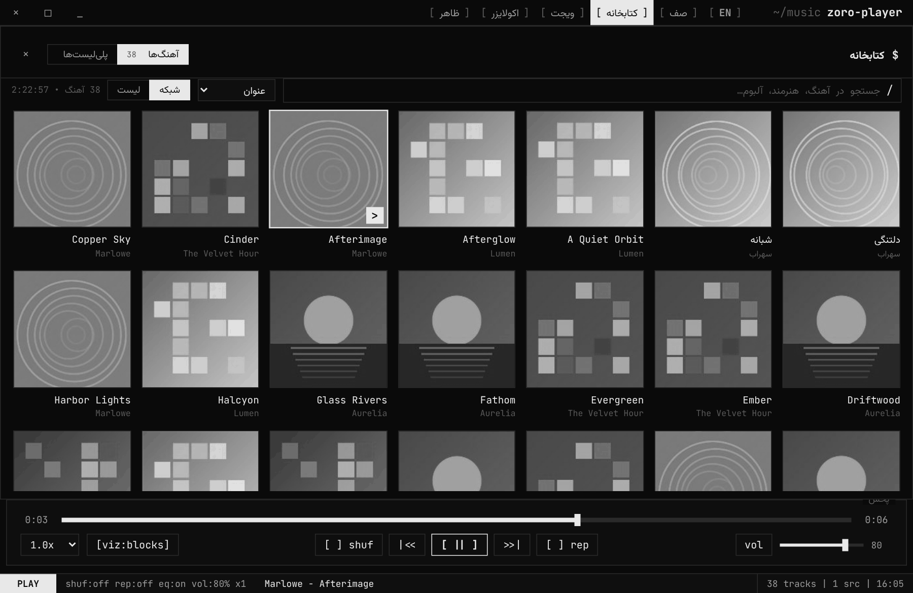
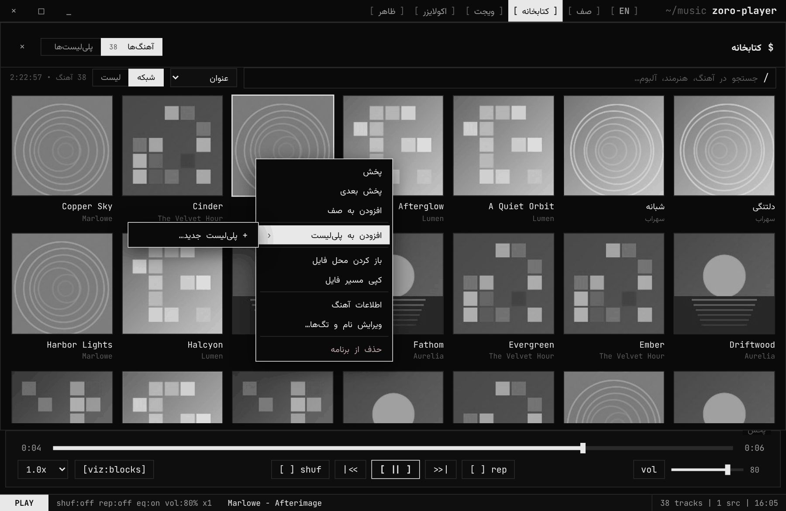
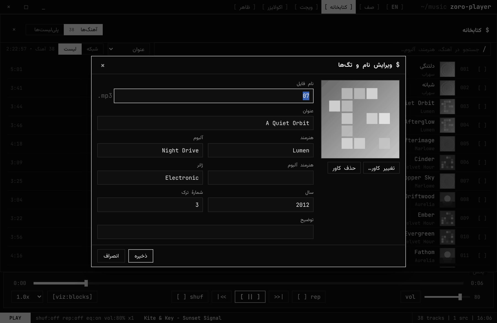
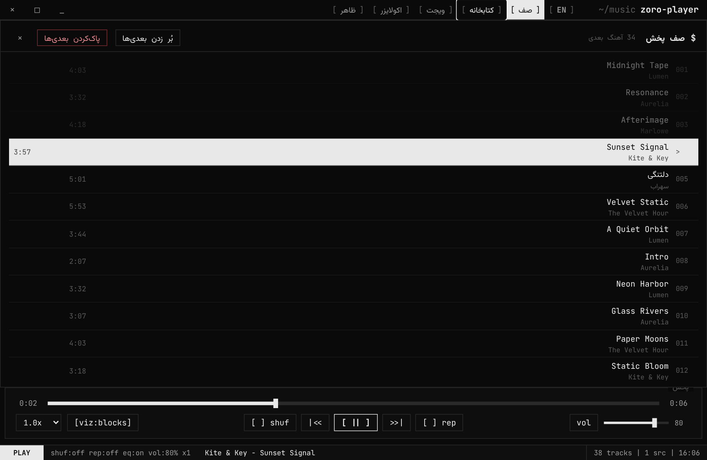
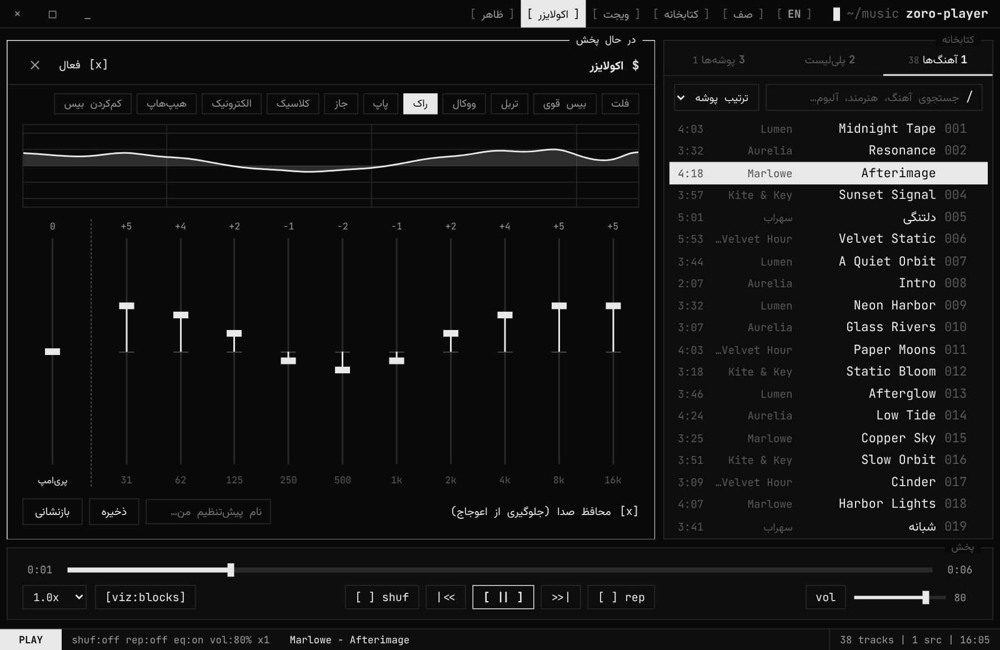
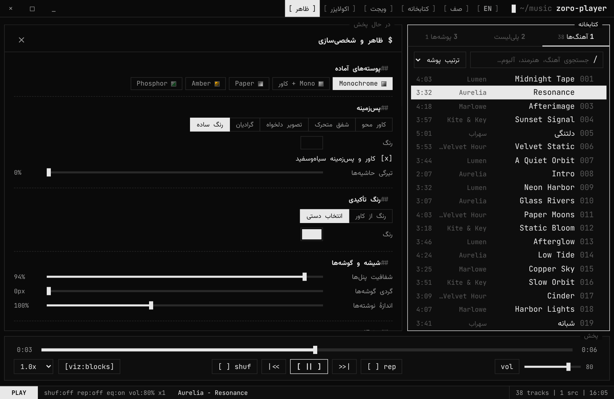
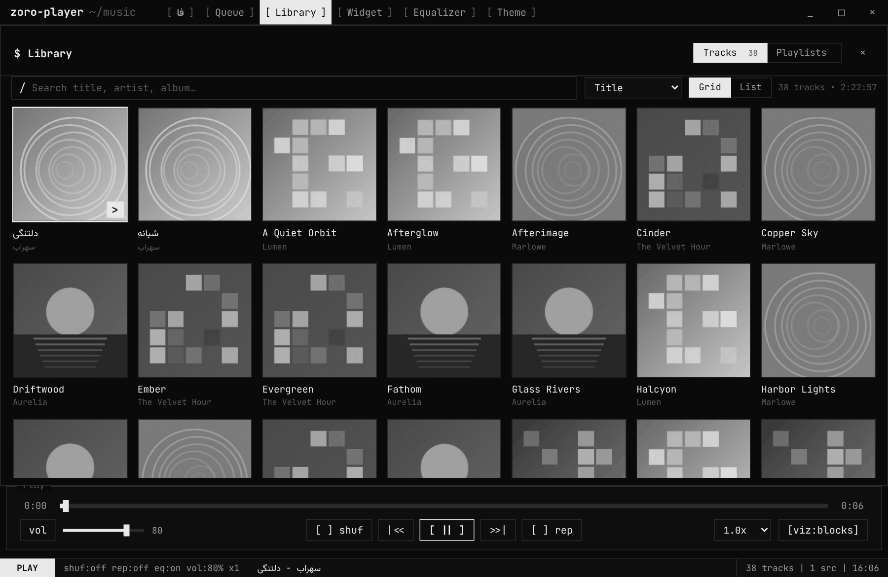
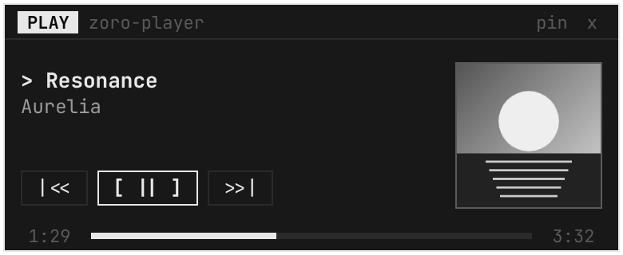

# Zoro Player

A Windows desktop music player built with **Tauri 2, Rust, and vanilla JavaScript**. Zoro Player combines a Persian-first, right-to-left interface with an English left-to-right option, powerful local-library tools, and a distinctive monochrome desktop design.

## A distinctive visual identity

Zoro Player is designed to feel less like a generic music app and more like a carefully crafted desktop environment. Its default **Monochrome** theme takes inspiration from Omarchy and terminal interfaces:

- A restrained black-and-white palette, crisp thin borders, and carefully tiled panels.
- Monospaced typography using JetBrains Mono, paired with Vazirmatn for Persian text.
- A compact, information-dense library layout with a terminal-like track list.
- A CAVA-inspired block visualizer and a minimal bottom status bar.
- Cover art integrated into the interface without overwhelming its clean monochrome identity.

The look is not locked to one style. Switch between **Monochrome**, **Mono + Cover**, **Paper**, **Amber**, and **Phosphor**, then fine-tune backgrounds, accent colors, blur, brightness, panel opacity, corner radius, cover presentation, and font size. The result is a music player with a recognizable visual character that can still be made your own.

## Screenshots

> The screenshots use generated sample artwork and fictional tracks.

| | |
|---|---|
|  |  |
| **Player** — now playing, cover art, block visualizer, track list | **Library** — every track with its cover, grid or list view |
|  |  |
| **Right-click menu** — play next, add to queue or playlist, show in folder, info, edit, remove | **Tag editor** — file name, all tags and embedded cover art |
|  |  |
| **Play queue** — reorder, remove, shuffle what plays next | **Equalizer** — 10 bands, preamp, presets and a live response curve |
|  |  |
| **Appearance** — themes, backgrounds, visualizer, cover and widget options | **English (LTR)** — the whole interface also works left-to-right |

<p align="center">
  <br>
  <em>Compact desktop widget</em>
</p>

## Download

Pre-built Windows packages are published on the [Releases](https://github.com/ZoroChanW/zoro-player/releases) page:

- **`Zoro Player_<version>_x64-setup.exe`** — installer with a Start-menu entry and uninstaller.
- **`Zoro-Player-portable-x64.exe`** — single portable executable (needs the WebView2 runtime, included with Windows 11 and current Windows 10).

Releases are built automatically by GitHub Actions whenever a `v*` tag is pushed (or when the **Build & Release (Windows)** workflow is started manually).

## Features

### Music library
- Add individual audio files or multiple folders, including nested subfolders.
- Drag and drop files or folders into the player.
- Browse tracks with cover art in grid or list view; search, sort, and multi-select.
- Cache metadata in SQLite for fast startup and incremental rescanning.
- Optionally watch music folders and refresh the library when files change.

### Playback and organization
- Create, rename, duplicate, customize, reorder, and delete playlists.
- Manage the play queue: add tracks, play next, reorder, shuffle, and remove tracks.
- Shuffle, repeat modes, playback speed, volume, mute, media keys, and resume-last-track.
- Keep playback running in the Windows system tray when the main window is closed.

### Track details and audio
- View and edit track titles, artist and album information, tags, embedded artwork, and file names.
- Read embedded cover art or common folder artwork files.
- 10-band equalizer with preamp, built-in and custom presets, live response curve, and optional limiter.
- Block, bar, mirrored, wave, and circular visualizers; cover artwork reacts to bass.
- Compact transparent desktop widget with cover art, playback controls, and a visualizer.

### Languages
- Persian (RTL) and English (LTR) interfaces, including the desktop widget.

## Audio formats

The library recognizes:

`mp3`, `flac`, `wav`, `ogg`, `oga`, `opus`, `m4a`, `aac`, `weba`, `webm`, `wma`, `ape`, `wv`, `aif`, `aiff`, `aifc`, `caf`, `mka`, `mpc`, and `tta`.

Formats supported by the Windows WebView audio engine play directly. Other formats are decoded to WAV by the Rust backend using Symphonia, with FFmpeg as a fallback where needed.

If FFmpeg is required, place `ffmpeg.exe` next to the application executable, in an `ffmpeg` subfolder beside it, or in the application's data directory. It can also be available through `PATH`, or selected with the `ZORO_FFMPEG` environment variable.

## Tech stack

| Component | Technology |
|---|---|
| Desktop framework | [Tauri 2](https://tauri.app/) |
| Backend | [Rust](https://www.rust-lang.org/) |
| Frontend | HTML, CSS, vanilla JavaScript |
| Audio metadata and tags | [Lofty](https://github.com/Serial-ATA/lofty) |
| Audio decoding | [Symphonia](https://github.com/pdeljanov/Symphonia), FFmpeg fallback |
| Library cache | SQLite via `rusqlite` |
| File discovery | `walkdir` |
| Folder monitoring | `notify-debouncer-mini` |
| Audio processing | Web Audio API |
| Visualizers | Canvas |

## Requirements

To build Zoro Player on Windows, install:

1. [Node.js](https://nodejs.org/)
2. [Rust](https://www.rust-lang.org/tools/install) with the MSVC toolchain
3. [Microsoft C++ Build Tools](https://visualstudio.microsoft.com/visual-cpp-build-tools/) with **Desktop development with C++**
4. [Microsoft Edge WebView2](https://developer.microsoft.com/microsoft-edge/webview2/) (usually already installed on Windows 10 and 11)

## Development

Clone the repository and install dependencies:

```powershell
git clone https://github.com/ZoroChanW/zoro-player.git
cd zoro-player
npm install
npm run dev
```

## Build

You can download ready-made builds from [Releases](https://github.com/ZoroChanW/zoro-player/releases). To build it yourself, create the Windows NSIS installer:

```powershell
npm run build
```

The installer is generated under:

```
src-tauri/target/release/bundle/nsis/
```

## Keyboard shortcuts

| Shortcut | Action |
|---|---|
| `Space` | Play / pause |
| `←` / `→` | Seek backward / forward by 5 seconds |
| `Ctrl + ←` / `Ctrl + →` | Previous / next track |
| `↑` / `↓` | Increase / decrease volume |
| `M` | Mute / unmute |
| `S` | Toggle shuffle |
| `R` | Cycle repeat mode |
| `E` | Open / close the equalizer |
| `V` | Change visualizer |
| `L` | Open the library |
| `Q` | Open the play queue |

## Data and privacy

Zoro Player is designed around a local music library. Track metadata is cached in a SQLite database in the application's data directory, while interface preferences and library-related state are persisted locally.

Your music files remain in their original locations. Removing a track from Zoro Player does **not** delete the file from disk.

## Fonts and licenses

The project bundles [JetBrains Mono](https://www.jetbrains.com/lp/mono/) and [Vazirmatn](https://github.com/rastikerdar/vazirmatn). Their Open Font License files are included in `src/fonts/`.

---

Made with care by [ZoroChanW](https://github.com/ZoroChanW).
